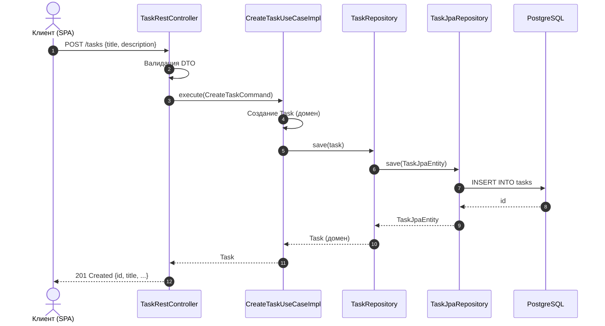

# System Patterns

## Обзор архитектуры

Приложение построено по принципам **гексагональной архитектуры** (порты и адаптеры). Это решение принято сознательно: 
бизнес-логика Todo-приложения не должна зависеть от фреймворков, БД или способа доставки (REST, CLI, gRPC). Если завтра 
потребуется второй интерфейс, домен останется неизменным.

Архитектура разделена на три слоя: `domain`, `application`, `infrastructure`. Правила зависимостей между слоями 
зафиксированы в `.cline/rules/architecture.md` — здесь они не дублируются.

## Обоснование ключевых решений

### Почему гексагональная архитектура, а не классическая слоистая

Классическая слоистая архитектура (Controller → Service → Repository) предполагает, что сервис знает о репозитории напрямую. 
Это означает, что при смене хранилища (например, с PostgreSQL на MongoDB) приходится менять сервис. В гексагональной
архитектуре сервис зависит от интерфейса (`TaskRepository`), а реализация подставляется извне. Это упрощает тестирование 
и изоляцию.

### Почему доменные модели не являются JPA-сущностями

Доменные модели (`Task`, `TaskStatus`, `Priority`) — обычные Java-классы без аннотаций. JPA-сущности (`TaskJpaEntity`) 
живут в `infrastructure.adapter.out.persistence`. Это разделение защищает домен от деталей ORM: ленивой загрузки, 
проксирования, каскадов. Домен не должен знать, что его сохраняют в БД.

Плата за это — маппинг между доменной моделью и JPA-сущностью. Он вынесен в отдельный класс-маппер.

### Почему Command / Query Separation

Команды (`CreateTaskCommand`) и запросы (`ListTasksQuery`) — разные типы. Команды изменяют состояние, запросы только 
читают. Это разделение упрощает понимание: глядя на имя класса, сразу ясно, есть ли побочные эффекты.

## Ключевой сценарий: создание задачи



## Структура основных пакетов 

```text
reb.ai.todo
├── domain
│   ├── models              User, Task
│   ├── port.in             CreateTaskUseCase, ListTasksUseCase, ...
│   ├── port.out            TaskRepository, UserRepository, ...
│   └── exception           TaskNotFoundException, ...
├── application
│   ├── service             CreateTaskUseCaseImpl, ListTasksUseCaseImpl, ...
│   └── exception           OrchestrationException, ...
└── infrastructure
    ├── adapter
    │   ├── in
    │   │   ├── rest        TaskRestController, AuthRestController, ...
    │   │   │   └── dto     CreateTaskRequest, TaskResponse, ...
    │   │   └── security    JwtAuthenticationFilter, ...
    │   └── out
    │       ├── persistence TaskJpaRepository, TaskJpaEntity, TaskMapper, ...
    │       └── security    JwtTokenProvider, ...
    ├── config              SecurityConfiguration, JpaConfiguration, ...
    └── exception           PersistenceException, ...
```
